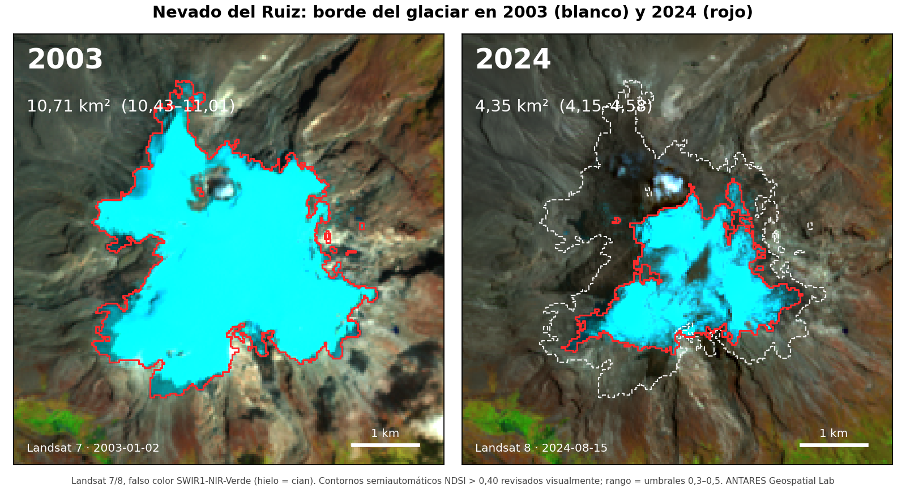
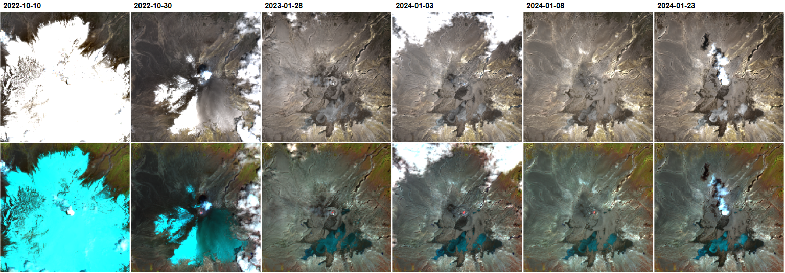

# Nevado del Ruiz: 40 años de glaciar, ceniza y clima (1985–2026)
> 🇬🇧 [English version](README.md)

> **Pregunta:** ¿Cuánta superficie glaciar ha perdido el Volcán Nevado del Ruiz desde 1985, con qué incertidumbre, y qué relación tiene con la temperatura y El Niño?
> **Usuarios potenciales:** IDEAM, Parques Nacionales, corporaciones autónomas regionales, academia.
> **Métrica principal:** área glaciar (km²) con rango de sensibilidad, contrastada entre fuentes y sensores.
> **Limitación principal:** la ceniza volcánica oculta el glaciar en temporada seca y la nieve fresca lo infla en temporada húmeda.

Proyecto #1 de **ANTARES Geospatial Lab**, portafolio de proyectos geoespaciales reproducibles con datos abiertos · Autor: **Cristhian Pastrana**, Ingeniero Agrícola.



## Resultados principales

| Hallazgo | Evidencia |
|---|---|
| El Ruiz perdió ~75 % de su superficie glaciar entre 1985 y 2024 | MapBiomas Colombia Col. 3: 14,73 → 3,68 km² |
| Escenas limpias independientes confirman la tendencia | Contornos Landsat: 10,71 km² (2003) → 4,35 km² (2024) |
| Sentinel-2 y Landsat coinciden el mismo día | Diferencias de 2–4 % |
| **La ceniza esconde el glaciar** | En temporada seca el hielo visible cae a ~0,5–1,5 km² y meses después vuelve a ~3–4 km² |
| La región se calienta | ERA5-Land: +0,10 °C/década (p = 0,005) |
| El Niño hace al Ruiz más cálido y seco | ρ = +0,54 con temperatura; ρ = −0,53 con lluvia (CHIRPS) |
| ¿El Niño acelera la pérdida de hielo? | Sugestivo (ρ = −0,30; p = 0,06), **no demostrado** |

📄 **Informe metodológico completo:** [`reports/informe_metodologia_nevado_del_ruiz.pdf`](reports/informe_metodologia_nevado_del_ruiz.pdf) — incluye todo lo que falló y por qué.



## Lo que falló (y se conserva documentado)

Un método automático estándar (máscara de nubes Fmask + NDSI) aceptó **5 de 2102 escenas Landsat**: inservible sobre el glaciar. Tres versiones del algoritmo (`gee/01_*`, `gee/02_*`) dieron series imposibles antes de identificar la causa: nubes de hielo, nieve fresca y ceniza. La solución fue selección visual de escenas con un criterio independiente, contornos semiautomáticos con análisis de sensibilidad y validación cruzada entre sensores.

## Estructura

| Carpeta | Contenido |
|---|---|
| `gee/` | Scripts de Google Earth Engine, numerados en orden de ejecución |
| `python/` | Contornos, análisis estadístico, figuras e informe (Python de QGIS 4.0.2) |
| `qgis/` | Proyecto QGIS y contornos (GeoPackage) |
| `data/processed/` | Series y tablas derivadas (CSV) |
| `data_registry/` | Ficha de cada fuente: procesamiento del proveedor, resolución, licencia |
| `sampling/` | Selección visual de escenas |
| `validation/` | Auditoría de MapBiomas, resultados de clima |
| `reports/` | Informe PDF, figuras, piezas de comunicación |

Los datos crudos (`data/raw/`) no se versionan: se regeneran con `gee/04_descargas_para_qgis.js` y `gee/06_clima_mensual.js`.

## Cómo reproducir

1. Ejecutar en el [Code Editor de Earth Engine](https://code.earthengine.google.com) `gee/03` → `gee/04` (descarga de GeoTIFF a `data/raw/`) → `gee/05` → `gee/06`.
2. Descargar el ONI de NOAA (`https://www.cpc.ncep.noaa.gov/data/indices/oni.ascii.txt`) en `data/raw/clima/oni_noaa_cpc.txt`.
3. Con el Python de QGIS:
   ```
   "C:\Program Files\QGIS 4.0.2\bin\python-qgis.bat" python\crear_proyecto_qgis.py
   "C:\Program Files\QGIS 4.0.2\bin\python-qgis.bat" python\delinear_semiauto.py
   "C:\Program Files\QGIS 4.0.2\bin\python-qgis.bat" python\analisis_clima_glaciar.py
   "C:\Program Files\QGIS 4.0.2\bin\python-qgis.bat" python\piezas_comunicacion.py
   "C:\Program Files\QGIS 4.0.2\bin\python-qgis.bat" python\informe_metodologia.py
   ```

## Estado y próximos pasos

| Fase | Estado |
|---|---|
| Series automáticas Landsat (v1–v3) | Descartadas y documentadas |
| Serie MapBiomas + auditoría con contornos propios | Hecho (contornos semiautomáticos, pendiente revisión manual) |
| Sentinel-2 + Cloud Score+ | Hecho |
| Clima y El Niño | Hecho (exploratorio) |
| Machine Learning para hielo bajo ceniza (v1) | Hecho: resultado negativo documentado — el ML parece funcionar (F1 0,88) pero se cae al dejar un sector fuera (F1 ≈ 0,25, igual que NDSI). Ver [`validation/ml_hielo_bajo_ceniza.md`](validation/ml_hielo_bajo_ceniza.md) |
| ML v2: Sentinel-1 radar, etiquetas independientes, transferencia a otro glaciar | Próximo |
| Páramo por franjas altitudinales · transferencia a Santa Isabel, Tolima y El Cocuy | Pendiente |

## Datos y licencias

Datos 100 % abiertos: USGS Landsat Collection 2, Copernicus Sentinel-2 y Cloud Score+ (Google), MapBiomas Colombia Colección 3, Copernicus DEM GLO-30, ERA5-Land (ECMWF), CHIRPS (UCSB-CHC), ONI (NOAA CPC). Detalle en [`data_registry/fuentes.md`](data_registry/fuentes.md). La licencia de reutilización de MapBiomas Colombia está pendiente de confirmar.

Código: MIT. Textos, figuras e informe: CC BY 4.0. Ver [`LICENSE`](LICENSE).

*Las cifras son estimaciones a partir de datos satelitales y reanálisis, no mediciones de campo.*
