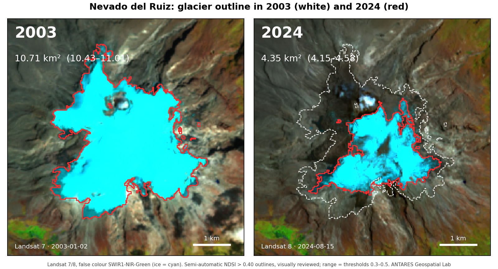
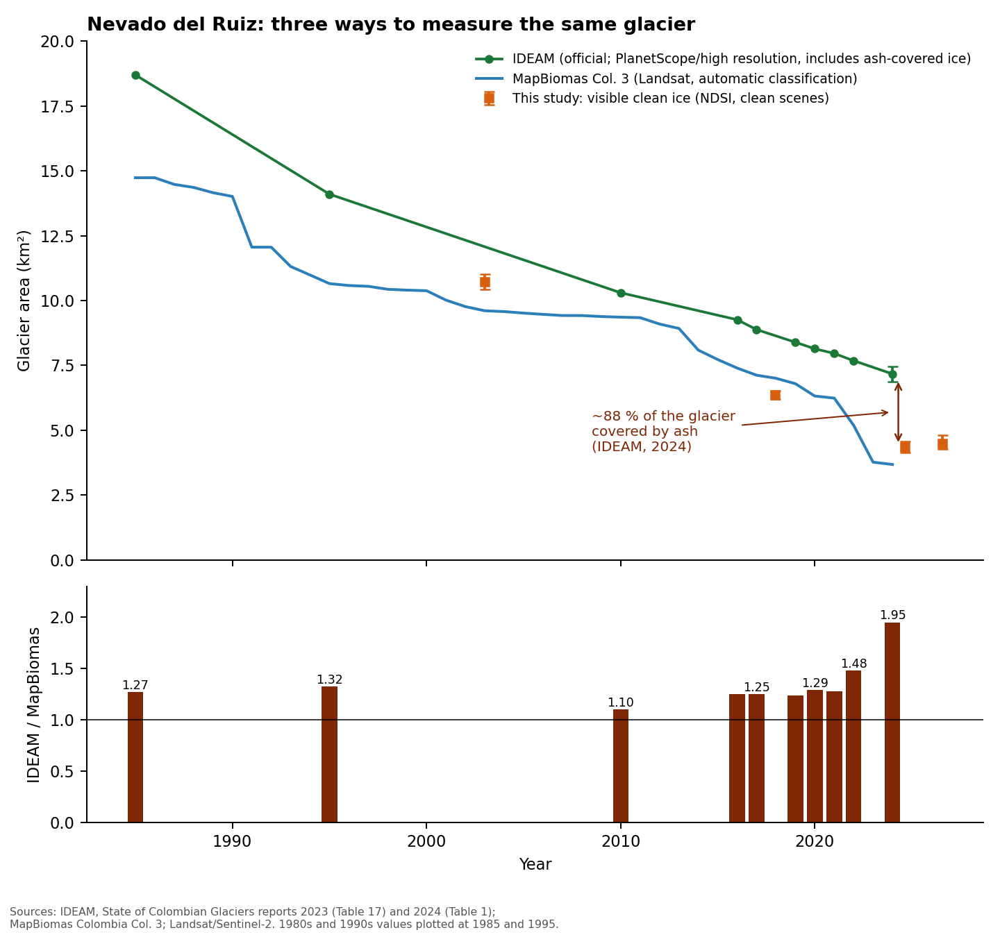
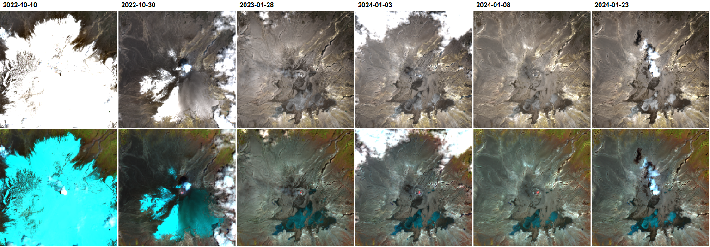
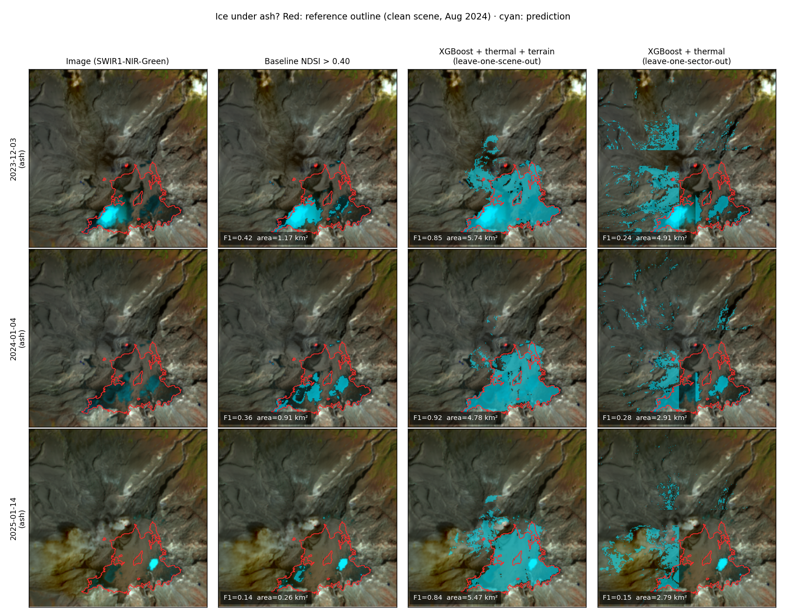

# Nevado del Ruiz: 40 Years of Glacier, Volcanic Ash and Climate (1985–2026)
> 🇪🇸 [Versión en español](README.es.md)

> **Question:** How much glacier area has Nevado del Ruiz volcano (Colombia) lost since 1985, with what uncertainty, and how does that loss relate to temperature and El Niño?
> **Potential users:** national hydro-meteorological agencies (IDEAM), protected-area managers, regional environmental authorities, researchers.
> **Main metric:** glacier area (km²) with a sensitivity range, cross-checked across data sources and sensors.
> **Main limitation:** volcanic ash hides the glacier in the dry season, and fresh snow inflates it in the wet season.

Project #1 of **ANTARES Geospatial Lab**, a portfolio of reproducible geospatial projects built on open data · Author: **Cristian Pastrana**, Agricultural Engineer.



## Key findings

| Finding | Evidence |
|---|---|
| Ruiz has lost most of its glacier since the 1980s: **~62 % according to the official IDEAM inventory**, ~75 % according to MapBiomas | IDEAM: 18.7 km² (1980s) → 7.17 ± 0.30 km² (2024). MapBiomas Col. 3: 14.73 → 3.68 km² (1985–2024) |
| **The official inventory independently confirms the ash effect** | IDEAM reports ~88 % of the glacier covered by ash in 2024. The IDEAM/MapBiomas area ratio grows from 1.1–1.3 (until 2021) to 1.95 (2024): spectral methods miss ash-covered ice. See [`validation/comparacion_ideam.md`](validation/comparacion_ideam.md) |
| Independent clean scenes confirm the trend | Landsat outlines: 10.71 km² (2003) → 4.35 km² (2024) |
| Sentinel-2 and Landsat agree on the same day | 2–4 % difference |
| **Volcanic ash hides the glacier** | In the dry season visible ice drops to ~0.5–1.5 km², then returns to ~3–4 km² months later |
| The region is warming | ERA5-Land: +0.10 °C/decade (p = 0.005) |
| El Niño makes Ruiz warmer and drier | ρ = +0.54 with temperature; ρ = −0.53 with rainfall (CHIRPS) |
| Does El Niño accelerate ice loss? | Suggestive (ρ = −0.30; p = 0.06), **not demonstrated** |
| Can machine learning map ice under ash? | **Not yet.** F1 = 0.88 with leave-one-scene-out, but 0.25 with leave-one-sector-out (same as the NDSI baseline): the apparent skill was spatial leakage |

📄 **Full methodology report (English):** [`reports/methodology_report_nevado_del_ruiz_en.pdf`](reports/methodology_report_nevado_del_ruiz_en.pdf) · Spanish: [`reports/informe_metodologia_nevado_del_ruiz.pdf`](reports/informe_metodologia_nevado_del_ruiz.pdf). Both include everything that failed and why.




*Sentinel-2, critical period. Top: true colour (ash appears grey). Bottom: false colour SWIR1-NIR-Green (ice under ash shows as dull blue-green with the glacier's shape).*

## What failed (and is kept on record)

- **Automatic mapping.** A standard pipeline (Fmask cloud mask + NDSI) accepted **5 of 2,102 Landsat scenes**, so it was unusable over this glacier. Three algorithm versions (`gee/01_*`, `gee/02_*`) produced physically impossible series before the cause was identified: ice clouds, fresh snow and volcanic ash. The fix was visual scene selection with an independent criterion, semi-automatic outlines with sensitivity analysis, and cross-sensor validation.
- **Machine learning.** Random Forest and XGBoost with spectral, thermal and terrain features scored **F1 = 0.88** when leaving one scene out. When a whole sector of the glacier was held out, F1 fell to **~0.25**. Permutation importance showed elevation dominating: the model learned *where* the glacier is, not *what ash-covered ice looks like*. Details: [`validation/ml_hielo_bajo_ceniza.md`](validation/ml_hielo_bajo_ceniza.md).



## Repository layout

| Folder | Contents |
|---|---|
| `gee/` | Google Earth Engine scripts, numbered in execution order |
| `python/` | Outlines, statistics, ML, figures and report (QGIS 4.0.2 Python) |
| `qgis/` | QGIS project and outlines (GeoPackage) |
| `data/processed/` | Derived series and tables (CSV) |
| `data_registry/` | One record per data source: provider processing, resolution, licence |
| `sampling/` | Visual scene selection |
| `validation/` | MapBiomas audit, IDEAM comparison, climate results, ML results |
| `reports/` | PDF reports (EN/ES), figures, communication pieces |

Raw data (`data/raw/`) is not versioned. It is regenerated with `gee/04`, `gee/06` and `gee/07`.

## How to reproduce

1. In the [Earth Engine Code Editor](https://code.earthengine.google.com), run `gee/03` → `gee/04` (GeoTIFF download into `data/raw/`) → `gee/05` → `gee/06` → `gee/07`.
2. Download NOAA's ONI (`https://www.cpc.ncep.noaa.gov/data/indices/oni.ascii.txt`) into `data/raw/clima/oni_noaa_cpc.txt`.
3. For machine learning, install scikit-learn and XGBoost for QGIS's Python into `.pylibs/`:
   ```
   "C:\Program Files\QGIS 4.0.2\bin\python-qgis.bat" -m pip install --target .pylibs --no-deps scikit-learn joblib threadpoolctl cloudpickle xgboost
   ```
4. With QGIS's Python, run in order: `crear_proyecto_qgis.py`, `delinear_semiauto.py`, `analisis_clima_glaciar.py`, `ml_hielo_bajo_ceniza.py`, `piezas_comunicacion.py`, `informe_metodologia.py`, `methodology_report_en.py`.

## Status and next steps

| Phase | Status |
|---|---|
| Automatic Landsat series (v1–v3) | Discarded and documented |
| MapBiomas series + audit with own outlines | Done (semi-automatic outlines, manual review pending) |
| Comparison with the official IDEAM glacier inventory | Done |
| Sentinel-2 + Cloud Score+ | Done |
| Climate and El Niño | Done (exploratory) |
| ML for ice under ash (v1) | Done: documented negative result |
| ML v2: Sentinel-1 radar, independent labels, transfer to another glacier | Next |
| Páramo by elevation band · transfer to Santa Isabel, Tolima and El Cocuy | Pending |

## Data and licences

100 % open data: USGS Landsat Collection 2, Copernicus Sentinel-2 and Cloud Score+ (Google), MapBiomas Colombia Collection 3, Copernicus DEM GLO-30, ERA5-Land (ECMWF), CHIRPS (UCSB-CHC), ONI (NOAA CPC). Details in [`data_registry/fuentes.md`](data_registry/fuentes.md). The reuse licence for MapBiomas Colombia is still to be confirmed.

Code: MIT. Text, figures and reports: CC BY 4.0. See [`LICENSE`](LICENSE).

*All figures are estimates from satellite data and reanalysis, not field measurements.*
